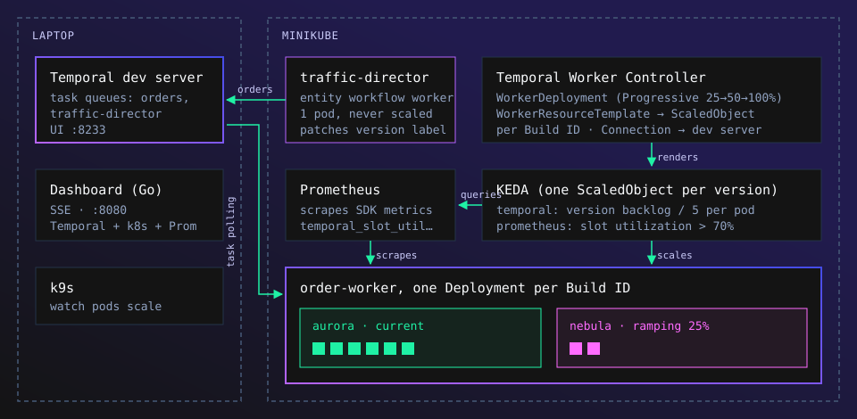
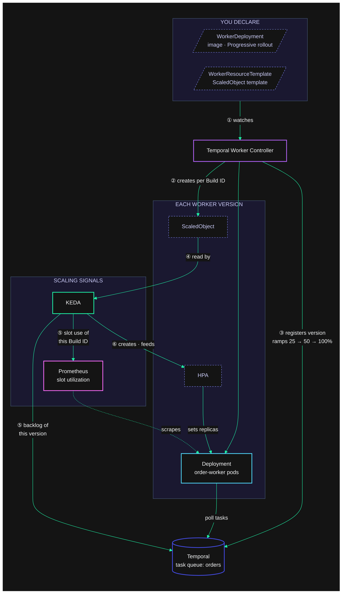

# Temporal Worker Autoscaling on Kubernetes


https://github.com/user-attachments/assets/b7be1768-7bd7-4d46-8857-3007b42a632b


A demo of Temporal workers scaling on Kubernetes.

- the [Temporal Worker Controller](https://github.com/temporalio/temporal-worker-controller) managing **versioned** workers (Worker Versioning, progressive rollouts, etc)
- **KEDA**, one `ScaledObject` per worker version (rendered by a `WorkerResourceTemplate`), scaling on the version's **task queue backlog** *and* **slot utilization**
- a **traffic director** entity workflow on its own worker that cycles traffic up and down forever and rolls out a new worker version every few cycles
- a dashboard in the temporal.io look (starfield, Ziggy) with a **live, embedded k9s** showing the real pods being scheduled and removed



## How it works

| Piece | What it does |
|---|---|
| `cmd/director` | Dedicated worker (task queue `traffic-director`) for the `TrafficDirector` entity workflow. Every 2s it starts a batch of `OrderWorkflow`s sized by a ~5 minute curve: idle → ramp up → peak → ramp down → cooldown. It continues-as-new each cycle. Every 3rd cycle it patches the `WorkerDeployment`'s pod-template annotation, which creates a new Build ID and starts a progressive rollout. Signals: `pause`, `resume`, `surge`, `rollout-now`. Update: `set-config`. Query: `state`. |
| `cmd/worker` | The order worker (task queue `orders`). Each pod gets only **4 activity slots**, so traffic forces scale-out. It uses poller autoscaling and Worker Versioning (`Pinned`), connects with the env vars the controller injects, and exports SDK metrics labelled per version. |
| `WorkerDeployment` | `Progressive` rollout (25% → 50% → 100%) with short sunset delays, so drained versions disappear quickly. |
| `WorkerResourceTemplate` | Renders a KEDA `ScaledObject` per Build ID with two triggers: `temporal` (that version's backlog; the controller injects the deployment/build ID) and `prometheus` (`temporal_slot_utilization`). KEDA uses whichever wants more pods. |
| `cmd/web` | Dashboard, running **in the cluster** (`deploy/k8s/dashboard.yaml`) and reached through a supervised `kubectl port-forward` on `localhost:8080`. It reads Temporal (director query, deployment routing, per-version backlog), Kubernetes (pods, replicas) and Prometheus (slots per pod), and streams them over SSE. Its **k9s panel** runs a real k9s inside the pod, streamed to the page through a PTY and xterm.js. That k9s uses the pod's own ServiceAccount (read-only, `demo` namespace only), so nothing from your laptop's kubeconfig is ever visible. |

### How the scaling works



1. You declare a **WorkerDeployment** (the worker image and its rollout strategy) and a **WorkerResourceTemplate** (a KEDA ScaledObject with the version-specific fields left blank).
2. For every worker version (Build ID), the **Temporal Worker Controller** creates a Deployment and renders a ScaledObject from the template, filling in that version's Build ID. It removes both once the version has drained.
3. The controller registers the version with **Temporal** and shifts new workflows onto it: 25% → 50% → 100%.
4. **KEDA** picks up each ScaledObject and creates an HPA for it.
5. KEDA reads two signals for that version alone: its **task queue backlog**, straight from Temporal, and its **slot utilization**, from Prometheus (scraped from the workers' SDK metrics).
6. KEDA feeds the HPA whichever signal asks for more pods, and the HPA sets that version's replica count.

The design follows Temporal's [scaling recommendations](https://github.com/temporalio/temporal-worker-controller/blob/main/docs/scaling-recommendations.md) for self-hosted or local servers:
- **Backlog** reacts fast.
- **Slot utilization** keeps busy pods from being scaled in just because the queue is momentarily empty.
- `minReplicaCount: 1` keeps every version polling, which rollouts need.

## Prerequisites

macOS or Linux with: Docker (Desktop) with **≥ 8 GB** and 6 CPUs available, `minikube`, `kubectl`, `helm`, `go` ≥ 1.27, and the `temporal` CLI

## Run it

```bash
make up          # dev server + minikube + cert-manager, Worker Controller, KEDA, Prometheus + images + workloads + dashboard
make k9s-window  # optional: pop k9s out into its own Terminal window
```

- Dashboard: <http://localhost:8080>. Press **`k`** (or the **k9s** button, or open `?k9s=1`) for the live k9s panel. Staff controls: `?controls=1`. Big screen: `?kiosk=1`.
- Temporal UI: <http://localhost:8233>

The first run takes a few minutes while it pulls charts and images. After that, `make up` is quick.

| Command | |
|---|---|
| `make stop` | Stop the host-side processes |
| `make down` | Stop host processes and the cluster (keeps it for a fast `make up`) |
| `make reset` | Delete the minikube cluster |
| `make status` | WorkerDeployment / WRT / ScaledObject / HPA / pods |
| `make logs` | Tail the host-side logs in `.run/` |
| `make k9s` / `make k9s-window` | Full-size k9s (inside the dashboard pod), here or in a new Terminal window |
| `make dashboard` | Rebuild and roll only the dashboard, without triggering a worker rollout |
| `make deploy` | Re-apply manifests. With new images (`make images deploy`) this is a manual rollout. |
| `make test` | Unit tests |
| `make record` | Re-record `docs/demo.{gif,mp4}`: one full cycle from the live dashboard (headless Chrome + ffmpeg) |

> **Already running a dev server on 7233?** Use another port for the demo: `make up TEMPORAL_PORT=7243` (the UI is then on 8243).

## Booth checklist

1. Give Docker Desktop ≥ 8 GB RAM. Turn off sleep and the screen saver.
2. `make up`, then open `http://localhost:8080/?kiosk=1&k9s=1`. The dashboard always fits its window without scrolling: full screen on a TV, a small monitor, or half the screen next to a terminal. It switches to a stacked layout in narrow windows and hides secondary text when space is tight.
3. **Proving it's real:** the k9s panel is a genuine k9s talking to the cluster. It sits beside the pod tiles at a fixed height (a full peak of pods, at most about a third of the screen), so new pods appear (flashing green) and terminating ones disappear without ever squeezing the chart. During rollouts, when there are more pods than rows, k9s scrolls its table. The pod tiles beside it shrink to fit instead of growing the row. For a full-size view, use `make k9s-window` (macOS) or `make k9s` in any terminal. Both attach to the same isolated k9s inside the dashboard pod.
   - **Take control:** click the k9s panel (its border turns green). Use `↑↓` to pick a pod, then **`ctrl-d`**, Tab to **OK**, and Enter to kill it. Within about 2 seconds the dashboard shows the pod terminating and its replacement starting, because the ReplicaSet brings it back. Press **`l`** on a pod for its live logs (orders being paid for and shipped, plus Temporal retrying injected failures) and `Esc` to go back. Click anywhere outside the panel to hand the keyboard back.
   - **Limits:** k9s can delete pods in `demo` and read their logs, and nothing else. It can't scale or delete deployments, exec into pods, or see other namespaces. Set `K9S_ALLOW_DELETE` to `"false"` in `deploy/k8s/dashboard.yaml` for a fully read-only panel.
4. Keep a staff tab at `?controls=1` for **Surge ⚡** (extra traffic for 60s), **Pause**, and **Roll out version**.
5. The dashboard is only reachable on `127.0.0.1` (via the port-forward) because the control endpoints are unauthenticated.

## Tuning

| Knob | Where | Default |
|---|---|---|
| Activity slots per pod | `ACTIVITY_SLOTS` in `deploy/k8s/order-worker.yaml` | 4 |
| Base / peak orders/s, phase lengths, rollout cadence | `DefaultConfig()` in `internal/director/profile.go`, or live via the `set-config` update | 0.6 / 10 /s, 30-90-60-90-30s, every 3 cycles |
| Min / max pods, triggers, HPA behavior | `deploy/k8s/order-worker-autoscaling.yaml` | 1 / 10, backlog 5 per pod, slots 70% |
| Rollout steps and sunset | `deploy/k8s/order-worker.yaml` | 25% / 50% for 45s each; scale-down 30s, delete 2m |
| Activity speed | `SPEED` env on the worker | 1 |

Change the director's config live without redeploying:

```bash
temporal --disable-config-file --address localhost:7233 workflow update execute \
  --workflow-id traffic-director --name set-config \
  --input '{"idleSeconds":30,"rampUpSeconds":60,"peakSeconds":60,"rampDownSeconds":60,"cooldownSeconds":30,"baseRate":0.6,"peakRate":12,"tickSeconds":2,"rolloutEveryNCycles":2}'
```

## Notes

- **Worker Controller build.** The demo pins a digest of the controller's `main` image, not the v1.12.0 release. v1.12.0 can't substitute `{{temporal_worker_build_id}}` tokens inside KEDA ScaledObjects ([#616](https://github.com/temporalio/temporal-worker-controller/pull/616) landed after it), which made every version scale on the whole deployment's slot utilization. Draining versions then stayed scaled up. Switch `image.tag` in `deploy/helm/worker-controller-values.yaml` back to a release once one includes #616.
- **Fast drainage.** The dev server is started with shorter version-drainage checks (`matching.wv.VersionDrainageStatus*`), so drained versions sunset within about a minute instead of several.
- **Your Temporal CLI profile is ignored.** The binaries and scripts ignore the Temporal CLI config file, so a default profile pointing at Temporal Cloud can't redirect the demo.
- **Fonts and images are bundled.** Aeonik, temporal.io's typeface, is commercial, so the dashboard uses Manrope with Noto Sans Mono (both OFL, bundled under `web/static/fonts`). The Temporal logo and Ziggy are Temporal brand assets.
